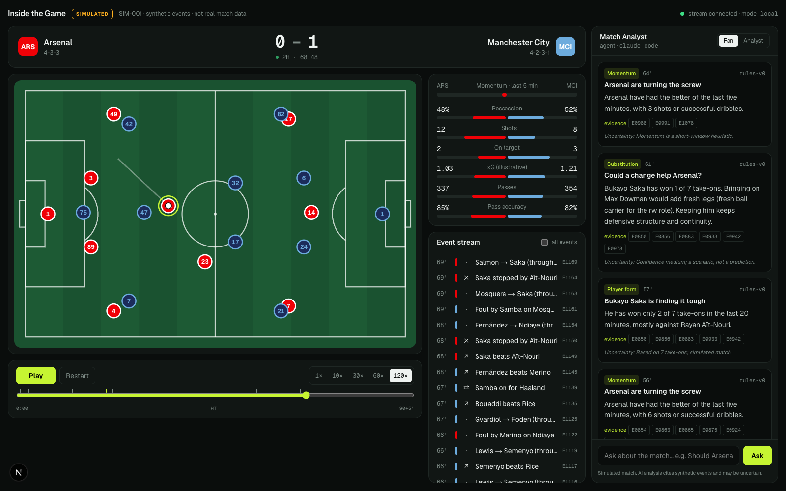

# Inside the Game

An AI-assisted football match centre. A seeded simulator produces a Premier League-style match as a stream of events. Deterministic services turn those events into live stats, ratings, alerts and substitution options, and an AI analyst explains them, citing the events behind every claim.

> **Everything here is simulated.** Club and player names are real reference data (2026–27 squads). Every match, event, rating, insight and recommendation is synthetic, is labelled as such, and is not real match data.



## Quick start

**Prerequisites:** macOS or Linux, [uv](https://docs.astral.sh/uv/), [bun](https://bun.sh), and [Claude Code](https://claude.com/claude-code) logged in. Claude Code powers the AI analyst through your subscription. Without it, the analyst falls back to rule-based answers.

```bash
scripts/install.sh      # uv sync + bun install + .env + synthetic data (~1s)
scripts/run.sh          # API on :8000, then web on :3000
```

Open **http://localhost:3000** and press **Play**.

**Demo path (3 minutes):**
1. Drag the timeline to about 50' and set the speed to 30×.
2. From 50', Doku (Man City, LW) keeps beating Frimpong (Liverpool, RB) in the channel. Around 62', with the score 0-0, the hot-duel trigger fires.
3. The bench options compare KEEP with substitutions such as Gomez and Bradley. Each option has pros, cons, evidence and stated uncertainty. At 70', Liverpool swap Szoboszlai into RB with Frimpong (a scripted `position_change`), and what happens next is not scripted.
4. Click an evidence chip to highlight that event on the pitch and in the feed.
5. Switch between **Fan** and **Analyst**. Both views are built from the same evidence, in different tones.
6. Ask *"Should Liverpool change their right back now?"*. Claude answers using the match tools.

## How it works

```
seeded generator ─► validator ─► SQLite ─► replay clock ─► SSE ─► Next.js match centre
                                              │
                         deterministic services (stats, rating v0, triggers, sub evaluator)
                                              │
                    agent tools (defined once) ─► REST · MCP /mcp/ · Claude Agent SDK
```

- **Events are the source of truth.** Scores, stats and ratings are always derived from the event ledger. The generator refuses to write a match that fails validation: FK integrity, chronology, on-pitch presence, possessions, and score reconciliation.
- **The AI never does arithmetic.** It calls read-only tools such as `get_match_state` and `evaluate_substitutions`. The only write tool is `publish_insight`, which rejects unknown evidence and evidence from after the replay clock.
- **Reproducible.** The same `SIM_SEED` produces identical events. Generation prints a hash so you can confirm this.

More detail in [docs/architecture.md](docs/architecture.md) and [docs/schema.md](docs/schema.md). The product spec is in `docs/` as a PDF.

## The AI analyst

| Path | What it does | Setup |
|---|---|---|
| **Rules agent** (always on) | Deterministic triggers publish templated fan/analyst insights during replay | none |
| **UI chat** → Claude Agent SDK | `POST /api/agent/ask` runs Claude with the match tools; falls back to rules on failure | `LOCAL_AGENT_PROVIDER=claude_code` (default) + Claude Code login |
| **Claude Code as live analyst** | Claude Code connects to the running backend over MCP and publishes insights straight to the UI | Run the app, open `claude` in the repo root, approve the `inside-the-game` server from `.mcp.json` |

Example prompt for Claude Code while the replay runs: *"Use the inside-the-game tools to watch SIM-001. Every few minutes, check the insight candidates and publish one grounded analyst insight with evidence."*

Other ways to authenticate Claude, such as an Anthropic API key, and the Azure AI Foundry plan for cloud mode, are documented in [docs/architecture.md §3](docs/architecture.md#3-agent-gateway).

## Configuration: local ↔ cloud

One root `.env` (created from `.env.example`) with four sections: **SWITCH** (`APP_MODE`), **SHARED**, **LOCAL\_\***, **CLOUD\_\***. Code reads only the resolved values for the active mode.

```bash
scripts/install.sh --mode cloud   # persist APP_MODE=cloud
scripts/run.sh --mode local       # override for one run
```

Cloud mode runs only the UI, pointed at `CLOUD_API_BASE_URL`. Cloud resources aren't provisioned yet. The plan is Terraform writing the `CLOUD_*` values into `.env`. The Azure equivalents (Static Web Apps, Container Apps, Azure SQL free offer, AI Foundry, and others) are mapped in [docs/architecture.md §5](docs/architecture.md#5-local--azure-mapping).

## Repository layout

```
backend/            FastAPI + uv (Python 3.13)
  app/sim/          seeded simulator, validator, generator (python -m app.sim.generate)
  app/services/     live state, metrics, rating v0
  app/agent/        tools, rules agent, Claude Agent SDK ask, MCP server
  app/seed/         real PL squads (reference data)
  tests/            pytest (23 tests)
frontend/           Next.js 16 + Tailwind v4 + Motion (src/components, src/lib)
docs/               spec PDF, architecture.md, schema.md
scripts/            install.sh, run.sh
.mcp.json           registers the backend MCP gateway for Claude Code
```

## Development

```bash
cd backend && uv run pytest -q && uv run ruff check .
cd backend && uv run python -m app.sim.generate      # rebuild synthetic data
cd frontend && bun run lint && bunx tsc --noEmit
scripts/run.sh --backend-only                        # API docs at http://127.0.0.1:8000/docs
```

## Known limitations (MVP)

- One demo match (`SIM-001`, Liverpool v Man City) with a scripted storyline, plus 20 historical fixtures used for baselines. The storyline, seed and hash are in `docs/schema.md` §11. The seed search never looks at events after the 70' swap.
- Rating v0 and xG are illustrative and uncalibrated. Player dots on the pitch are visual only, not tracking data.
- Single-process replay clock shared by all viewers. No auth. Cloud provisioning is not built yet.
