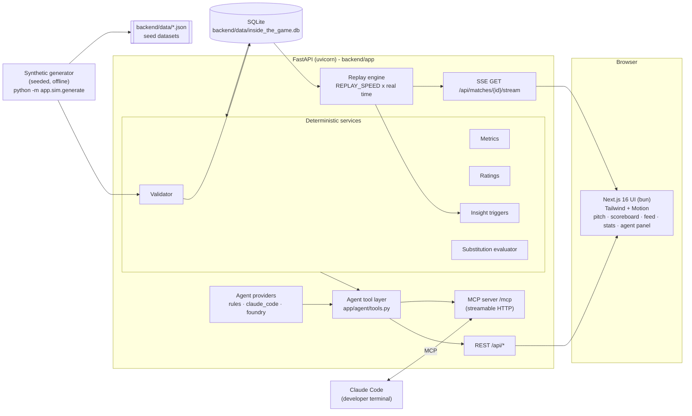
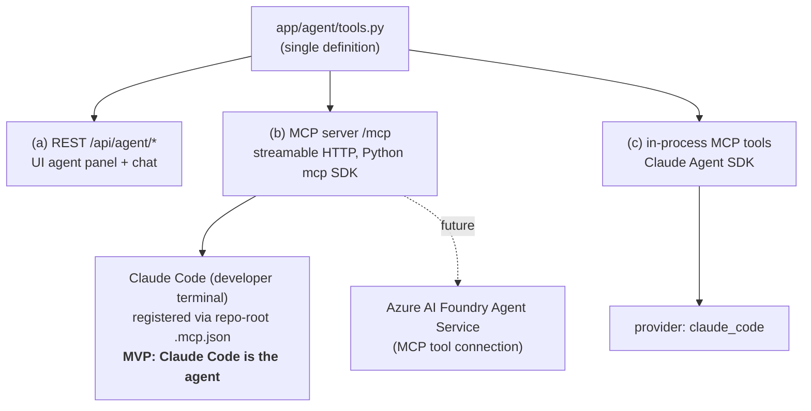
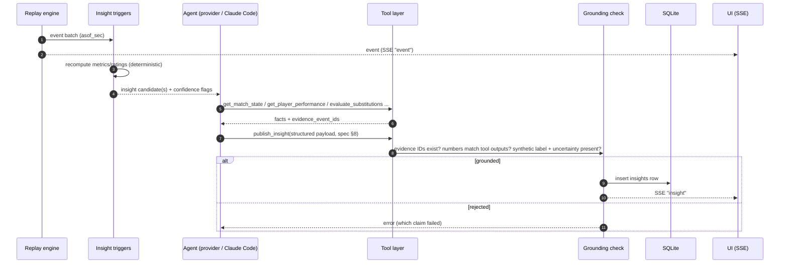
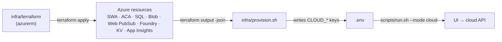
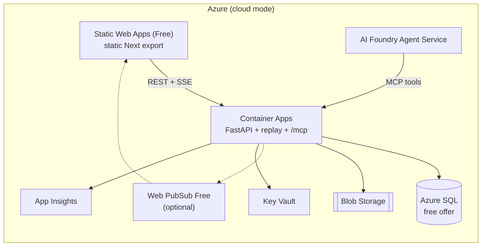
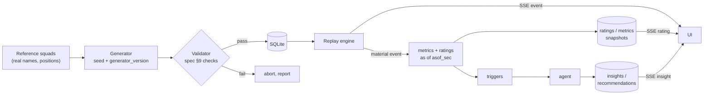

# Inside the Game: MVP Architecture

> **Everything here is synthetic.** The clubs are real Premier League clubs (Arsenal, Manchester City,
> Liverpool, Chelsea, Manchester United) and use real squad names. Every match, event, rating, insight
> and recommendation is simulated, and the app labels it as simulated.

The design is **local-first**: the whole MVP runs on one machine with `scripts/install.sh` and
`scripts/run.sh`. Each local component has a named Azure equivalent (free tier where one exists), and
one `.env` switch moves the app between the two (see [§4](#4-environment-switching-local--cloud)).

---

## 1. Overview and guiding principles

| Principle | What it means in the architecture |
|---|---|
| **Events are the source of truth** | The generator emits linked possession and event sequences. Scores, stats and ratings are always *derived* from the event ledger and never stored as independent totals. |
| **The AI never does arithmetic** | Python services compute every number: validator, metrics, ratings, triggers, substitution evaluation. The agent reads them through tools and only narrates. |
| **Evidence IDs on every claim** | Insights and recommendations carry `evidence_event_ids`, metric IDs and model or algorithm versions. A grounding check rejects anything that cites unknown evidence. |
| **Synthetic labelling** | `source_type = synthetic_simulation`, `synthetic = true` on matches, and a visible "SIMULATED" badge in the UI. |
| **Reproducible** | A fixed `SIM_SEED` plus `generator_version` reproduces the same events and metrics. |
| **Local-first, cloud-switchable** | One `.env` with `LOCAL_*` and `CLOUD_*` sections. `APP_MODE` selects which one is active. Application code only reads the resolved values (`backend/app/config.py`). |
| **No tracking-derived claims** | Player dots on the pitch are display-only. They come from formation slots plus the ball location and are never used for metrics. |

Reference pipeline (spec §1): generator → event validator → feature aggregator → role-aware rating →
insight triggers and candidate ranking → AI analyst agent → fan/analyst UI with traceable evidence.

---

## 2. Local component view



| Component | Responsibility |
|---|---|
| **Synthetic generator** | Runs offline from `install.sh`. Builds clubs and squads from reference data, samples ability priors from archetypes, schedules fixtures, simulates a possession state machine and emits linked events. Writes to SQLite and JSON. |
| **Validator** | Checks the spec §9 rules: FK integrity, chronology, on-pitch presence, possession changes, score/stat reconciliation, coordinate bounds. It runs during generation, and an invalid match does not load. |
| **Replay engine** | Reads the demo match ordered by `sequence_no` and emits events over SSE at `REPLAY_SPEED` match-seconds per wall-second. Supports play, pause, seek and speed. After each *material* event it triggers recomputation. |
| **Deterministic services** | Metrics (pass accuracy, take-on success, progressive actions, shots), a role-aware 0–10 live rating, a historical expected rating (prior matches only), insight triggers (momentum, pressure, tactical shift, underperformance) and a substitution evaluator (KEEP plus 2–4 eligible options). |
| **Agent tool layer** | The one place where agent tools are defined (see §3). |
| **Next.js UI** | Animated pitch (Motion), scoreboard, event feed, live stats and ratings, and an agent panel with clickable evidence chips. Has a fan/analyst toggle. Talks to the API via `NEXT_PUBLIC_API_BASE_URL`. |

---

## 3. Agent gateway

The tools are defined **once**, in `backend/app/agent/tools.py`, as plain Python functions with typed
(Pydantic) inputs and outputs. They wrap the deterministic services and **cannot change match facts or
ratings**.

| Tool | Kind | Input | Output |
|---|---|---|---|
| `get_match_state` | read | `match_id, asof_sec` | Score, formations, active players, available bench |
| `get_player_performance` | read | `match_id, player_id, asof_sec` | Current metrics and rating, plus source event IDs |
| `get_player_history` | read | `player_id, role, lookback` | Comparable historical baseline and sample size |
| `get_matchup_analysis` | read | `player_id, defender_id, match_id` | Observed simulated duel data and historical context |
| `evaluate_substitutions` | read | `match_id, team_id, asof_sec` | KEEP and eligible sub options with scores, risks and evidence |
| `get_insight_candidates` | read | `match_id, since_sec` | Statistical triggers and confidence flags |
| `publish_insight` | **write (only one)** | Spec §8 insight payload | Validates that the evidence IDs exist and that numbers match tool outputs, stores the row in `insights` and pushes an `insight` event on the SSE stream |

### The tools are exposed three ways



- **(a) REST** is used by the UI for tool results, the insight feed and chat.
- **(b) MCP at `/mcp`** is listed in a repo-root `.mcp.json`. A Claude Code session in the repo connects
  to the running backend, watches the match through the read tools and posts analysis with
  `publish_insight`. In the MVP, this is how "Claude Code is the agent".
- **(c) Agent SDK** handles chat questions typed in the UI when `LOCAL_AGENT_PROVIDER=claude_code`. The
  backend runs Claude through the Claude Agent SDK and registers the same tools as in-process MCP tools.
  It authenticates with the local Claude Code login or `ANTHROPIC_API_KEY`.
- **Later**, Azure AI Foundry Agent Service uses the same `/mcp` endpoint, so the tool code doesn't
  change.

### Providers (`LOCAL_AGENT_PROVIDER` / `CLOUD_AGENT_PROVIDER`)

| Provider | Where | Behaviour | Needs |
|---|---|---|---|
| `rules` | local and cloud | Fills deterministic templates from trigger and tool output. It always works, so the demo is safe even with no network. | nothing |
| `claude_code` | local | Claude answers through the Agent SDK using the shared tools. Claude Code can also push insights through `/mcp`. | Claude Code login or `ANTHROPIC_API_KEY` |
| `foundry` | cloud | An Azure AI Foundry agent with a small Azure OpenAI model calls `/mcp` | Foundry endpoint and agent ID (`CLOUD_FOUNDRY_*`) |

**Implemented (MVP):** `LOCAL_AGENT_PROVIDER=claude_code` is the default. The `rules` agent always runs as well, publishing deterministic trigger insights during replay; Claude adds chat answers and richer narrative on top. If the Agent SDK fails for any reason, `/api/agent/ask` falls back to `rules` and says so in the answer.

**How Claude is authenticated** (all three are supported by the Claude Agent SDK, pick one):

| Method | Setup | When to use |
|---|---|---|
| Claude Code login (subscription) | `claude` logged in on this machine; nothing in `.env` | **Current default** for local development and demos |
| Anthropic API key | `export ANTHROPIC_API_KEY=...` before `scripts/run.sh` (takes precedence over the login) | Shared/CI environments, usage-based billing |
| Azure AI Foundry | `CLOUD_AGENT_PROVIDER=foundry` + `CLOUD_FOUNDRY_*` | Cloud mode (future); Foundry agent calls the same `/mcp` tools |

The MCP gateway is served at **`http://127.0.0.1:8000/mcp/`** (stateless streamable HTTP; trailing slash required).

### Insight loop



Structured output contract (spec §8): `insight_id, kind, match_id, asof_sec, audience (fan|analyst),
headline, explanation, evidence_event_ids[], recommendation_id?, uncertainty, generator_version`.
The fan and analyst variants describe the same evidence.

---

## 4. Environment switching (local ↔ cloud)

There is one root `.env`, created from `.env.example` by `install.sh`. It has four sections:

| Section | Keys | Notes |
|---|---|---|
| **SWITCH** | `APP_MODE=local\|cloud` | Selects the active section |
| **SHARED** | `SIM_SEED`, `REPLAY_SPEED`, `CORS_ORIGINS` | Used in both modes |
| **LOCAL** | `LOCAL_API_HOST/PORT`, `LOCAL_WEB_PORT`, `LOCAL_API_BASE_URL`, `LOCAL_DATABASE_URL`, `LOCAL_DATA_DIR`, `LOCAL_AGENT_PROVIDER` | Defaults run everything on localhost with SQLite |
| **CLOUD** | `CLOUD_API_BASE_URL`, `CLOUD_DATABASE_URL`, `CLOUD_DATA_DIR`, `CLOUD_AGENT_PROVIDER`, `CLOUD_REALTIME_URL`, `CLOUD_FOUNDRY_ENDPOINT`, `CLOUD_FOUNDRY_AGENT_ID`, `CLOUD_APPINSIGHTS_CONNECTION_STRING` | Blank until provisioned |

- `backend/app/config.py` resolves `api_base_url`, `database_url`, `data_dir` and `agent_provider` from
  the active section. Application code never reads `LOCAL_*` or `CLOUD_*` keys directly.
- `scripts/install.sh [--mode local|cloud]` installs dependencies, generates the synthetic data and
  **persists** `APP_MODE` in `.env`.
- `scripts/run.sh [--mode local|cloud]` **overrides** the mode for one run.
  - `local` starts the API, waits for `/health`, then starts the UI.
  - `cloud` starts **only the UI**, pointed at `CLOUD_API_BASE_URL`. It refuses to start if that value
    is blank.
- The UI receives `NEXT_PUBLIC_API_BASE_URL` and `NEXT_PUBLIC_APP_MODE` from `run.sh`.

### Future: provisioning writes the CLOUD section



*This is not implemented yet. `install.sh --mode cloud` currently prints a warning and asks you to fill
in the `CLOUD_*` values by hand.*

---

## 5. Local → Azure mapping

> Free-tier figures are **as of Oct 2026. Verify them before provisioning**, because Microsoft changes
> limits. The sources are listed below the table.

| Concern | Local (MVP) | Azure equivalent | Free tier notes |
|---|---|---|---|
| Web UI | `next dev` (bun) | **Azure Static Web Apps, Free** | 100 GB/month bandwidth, 500 MB total storage (250 MB per app), 2 custom domains. Hybrid Next.js (SSR/RSC) is in **preview** with a 250 MB app limit, and the linked backends it relies on need the Standard plan. **MVP plan:** the UI is client-driven (SSE + REST), so ship a static export calling ACA directly. Before building, check that `cacheComponents` is compatible with static export. |
| API + replay/SSE | uvicorn + FastAPI | **Azure Container Apps (Consumption)** | Free grant of 180,000 vCPU-s, 360,000 GiB-s and 2M requests per subscription per month. Scales to zero, and SSE works over its HTTP ingress. Fallback: App Service F1 (Linux), which has a daily CPU quota and always-on restrictions. |
| Realtime fan-out | Direct SSE from the API | **Azure Web PubSub, Free** (or SignalR Free), *optional* | 20 concurrent connections and 20,000 outbound messages per unit per day. Messages over the limit are blocked, not billed. Only needed if many viewers share one replay. |
| Event streaming at scale | In-process replay engine | **Azure Event Hubs** (+ Stream Analytics) | **Not free**: Basic tier is billed. Future work only. |
| Relational DB | SQLite (`backend/data/inside_the_game.db`) | **Azure SQL Database, free offer** | 100,000 vCore-s, 32 GB data and 32 GB backup per DB per month, with no expiry, up to 10 DBs per subscription. Choose **auto-pause at limit** to avoid charges, and check vCore and storage settings when creating it. Alternative: Postgres Flexible Server B1ms (12 months free on a new account). |
| Files / synthetic datasets | `backend/data/*.json` | **Azure Blob Storage** | 5 GB LRS free for 12 months on a new account. Otherwise it costs a few cents at this scale. |
| Agent | `rules` / Claude Code via `/mcp` / Agent SDK | **Azure AI Foundry Agent Service** + Azure OpenAI small model | Pay-as-you-go, with no meaningful free tier. Keep `rules` as a fallback so the demo never depends on model availability. |
| Secrets | `.env` | **Azure Key Vault** | Charged per operation, negligible at MVP scale. ACA reads secrets via managed identity. |
| Observability | stdout logs | **Application Insights / Azure Monitor** | Free monthly ingestion allowance (about 5 GB). Set a daily cap. |
| Container images | none (runs from source) | **GitHub Container Registry** | Free for public images. Avoids ACR Basic, which has a monthly charge. |
| IaC | shell scripts | **Terraform (`azurerm`)** in `infra/` | Free. See the §4 flow. |
| CI/CD | none | **GitHub Actions** | Free minutes on public repos and a monthly allowance on private ones. |

Sources:
- [Azure Container Apps billing](https://learn.microsoft.com/en-us/azure/container-apps/billing)
- [Azure SQL Database free offer](https://learn.microsoft.com/en-us/azure/azure-sql/database/free-tier?view=azuresql)
- [Free offer FAQ](https://learn.microsoft.com/en-us/azure/azure-sql/database/free-offer-faq?view=azuresql)
- [Static Web Apps quotas](https://learn.microsoft.com/en-us/azure/static-web-apps/quotas)
- [Static Web Apps plans](https://learn.microsoft.com/en-us/azure/static-web-apps/plans)
- [Hybrid Next.js on Static Web Apps](https://learn.microsoft.com/en-us/azure/static-web-apps/deploy-nextjs-hybrid)
- [Web PubSub billing model](https://learn.microsoft.com/en-us/azure/azure-web-pubsub/concept-billing-model)
- [Azure subscription service limits](https://learn.microsoft.com/en-us/azure/azure-resource-manager/management/azure-subscription-service-limits)



---

## 6. Data flow



- **Offline:** the generator writes the historical fixtures (baselines) and the one demo match. Only
  matches that pass validation are loaded.
- **Live:** the replay engine streams the demo match. Metrics and ratings are recomputed **as of a
  given second**, with a snapshot after every *material* event (shot, goal, card, substitution, failed
  take-on, turnover), and use only events at or before `asof_sec`. Historical baselines use **prior
  matches only**, so no future data leaks in.
- **SSE event types:** `event`, `state` (score/clock), `rating`, `insight`, `recommendation`,
  `control` (play/pause/seek acknowledgements).
- **Player dots** are computed by the UI from formation slots, shifted toward the ball's `x,y`. They
  are display-only.

---

## 7. Repo layout (target)

```
inside_the_game/
├── .env.example            # SWITCH / SHARED / LOCAL_* / CLOUD_*
├── .mcp.json               # registers the backend /mcp server for Claude Code
├── CLAUDE.md  README.md
├── backend/                # uv project (Python 3.13)
│   ├── app/
│   │   ├── config.py       # mode-aware settings
│   │   ├── main.py         # FastAPI app, CORS, /health, routers, /mcp mount
│   │   ├── models/         # Pydantic schemas (canonical contract)
│   │   ├── sim/            # seeded generator + reference squads
│   │   ├── services/       # validator, metrics, ratings, triggers, substitutions, replay
│   │   ├── agent/          # tools.py, providers (rules, claude_code, foundry), grounding
│   │   └── api/            # REST + SSE routers
│   ├── data/               # generated (gitignored): SQLite + JSON
│   └── tests/
├── frontend/               # Next.js 16 + bun + Tailwind + Motion
│   └── src/{app, components, lib}
├── docs/                   # spec PDF, architecture.md, schema.md
├── scripts/                # install.sh, run.sh, _common.sh
└── infra/                  # future: terraform + provision.sh
```

---

## 8. Out of scope for the MVP (future)

- Tracking frames and off-ball or spacing metrics (`tracking_frames` table). The MVP makes no
  tracking-derived claims.
- Event Hubs / Stream Analytics ingestion and multiple concurrent live matches.
- Authentication, user profiles, personalised notifications.
- 20-club, season-scale simulation and opponent-adjusted form.
- Calibrated xG/xA/xT, counterfactual substitution rollouts and confidence intervals. MVP xG, if shown,
  is labelled illustrative.
- Broadcaster surfaces (captions, recap scripts) and multilingual output.
- Terraform provisioning and the automatic writing of the `CLOUD_*` section (designed in §4, not built).
