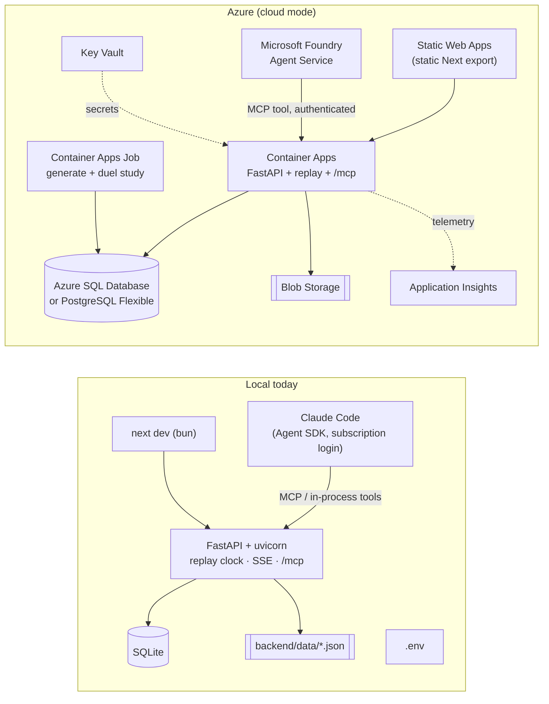

# Running Beyond the Touchline on Microsoft Azure

**Status (Oct 2026):** the app runs fully **locally** today (`scripts/install.sh`, `scripts/run.sh`). Cloud mode (`APP_MODE=cloud`) is designed but not built.

- **Infrastructure-as-code is deliberately deferred.** The owner has decided to leave the Terraform scripts out for now. This document lists every Azure service that replaces a local component, the code changes each one needs, and a manual provisioning order until Terraform is written.
- **Verify before provisioning.** Product names, free tiers and preview status change often. Every figure here was checked in Oct 2026; re-check the linked Microsoft Learn pages before you create anything.

Related:
- `docs/architecture.md` §4–§5: the environment model, plus a cost and free-tier table for each service.
- `.env.example`: the `CLOUD_*` keys that cloud mode reads.

---

## 1. At a glance

---

## 2. Service-by-service swap

| # | Concern | Local today | Azure service | What changes in the code or config |
|---|---|---|---|---|
| 1 | **Web UI** | `next dev` on :3000 (bun) | **Azure Static Web Apps** (Free plan), serving a static export | Build with `output: "export"` and check it works with `cacheComponents`. The bench route `/match/[id]/bench` must either be generated for `SIM-001` (`generateStaticParams`) or become a client route. Alternative: run `next start` in **Container Apps** if server rendering is needed. `NEXT_PUBLIC_API_BASE_URL` is set at build time to the API URL. |
| 2 | **API, replay clock, SSE, `/mcp`** | uvicorn + FastAPI in one process | **Azure Container Apps** (Consumption) | Containerise `backend/` (a uv-based Dockerfile). The replay clock and SSE subscribers live **in process**, so run **exactly one replica** (`minReplicas = maxReplicas = 1`) until fan-out moves out (row 6). SSE already sends a keep-alive every 15 s, so ingress idle timeouts are not a problem. Restrict `CORS_ORIGINS` to the Static Web Apps domain. |
| 3 | **Relational database** | SQLite file (`backend/data/beyond_the_touchline.db`) | **Azure SQL Database** (free offer), or **Azure Database for PostgreSQL – Flexible Server** | `backend/app/db.py` uses `sqlite3` directly and SQLite-style SQL. Port it to a driver-agnostic layer (SQLAlchemy Core) with `pyodbc` (SQL Server) or `psycopg` (Postgres). `Store` loads everything into memory at start-up (about 33k events), so the database is read-mostly and a small tier is enough. Don't put SQLite on Azure Files: file locking is unreliable. |
| 4 | **Synthetic data + duel study** | `scripts/install.sh` runs `app.sim.generate` and `app.analysis.duel_study` | **Container Apps Job** (manual or scheduled trigger) | The same two commands run in the API's image as a one-off job that writes to the cloud database. `variable_importance.json` goes to Blob Storage (row 5) or into a database table. Rule: same `SIM_SEED` + generator version ⇒ the same demo hash, so the job's log should print it as a check. |
| 5 | **Files** | `backend/data/*.json`, generated docs | **Azure Blob Storage** | `load_importance()` reads from a blob (managed identity) instead of a local path. `CLOUD_DATA_DIR` = the container URL. |
| 6 | **Real-time fan-out** (optional) | SSE straight from the API process | **Azure Web PubSub** (Free unit) or **Azure SignalR Service** | Only needed for many viewers or more than one API replica. The replay engine publishes `event` / `state` / `insight` / `recommendation` messages to a hub, and the UI subscribes. `CLOUD_REALTIME_URL`. |
| 7 | **AI analyst + coach briefing** | **Claude Code** through the Claude Agent SDK (`app/agent/ask.py`, subscription login), and Claude Code acting as the live analyst over `/mcp` | **Microsoft Foundry Agent Service** (formerly Azure AI Foundry) — see §3 | Implement the `foundry` provider (today `CLOUD_AGENT_PROVIDER=foundry` silently falls back to `rules`). The tools stay the same: `app/agent/tools.py` behind `/mcp`. |
| 8 | **Rules agent** | in-process `RulesAgent` | unchanged, inside the Container App | Nothing. It keeps the demo working when no model is available, so keep it as the fallback. |
| 9 | **Secrets** | `.env` | **Azure Key Vault** + a **managed identity** on the Container App | The database connection string, Foundry key (if not using Entra), and MCP access key become Key Vault references in the Container App's secrets. Never put them in `NEXT_PUBLIC_*`. |
| 10 | **Identity and access** | none (localhost) | **Microsoft Entra ID**: managed identities for service-to-service access; optional **Easy Auth** on the Container App for viewers | Use managed identity for SQL, Blob, Key Vault and Foundry. Decide whether the demo is public or behind Entra sign-in. |
| 11 | **`/mcp` endpoint security** | open on 127.0.0.1 | Same endpoint, **authenticated** | **Required before going public:** today `/mcp` has no authentication and exposes `publish_insight`. Add a bearer key (from Key Vault) or Entra token validation in front of the MCP mount. Foundry's MCP tool sends it as a header via a project connection. |
| 12 | **Observability** | stdout logs | **Application Insights** (Azure Monitor, OpenTelemetry) | Add `azure-monitor-opentelemetry` to the backend, and record agent and tool calls as spans. `CLOUD_APPINSIGHTS_CONNECTION_STRING`. Set a daily ingestion cap. |
| 13 | **Container images** | none (runs from source) | **GitHub Container Registry** (free for public images) or **Azure Container Registry** | Build the backend image in CI. |
| 14 | **CI/CD** | none | **GitHub Actions**, using OIDC federated credentials to Azure (no stored secrets) | Run the tests (`uv run pytest`, `bun run lint`), build and push the image, deploy the Container App and Job, and deploy Static Web Apps. |
| 15 | **Infrastructure-as-code** | shell scripts | **Terraform (`azurerm`)** in `infra/` — **deferred by owner decision** | Until then, provision manually (§5) and fill `CLOUD_*` in `.env` by hand. The planned flow is `terraform apply` → `terraform output -json` → `infra/provision.sh` writes the `CLOUD_*` keys (architecture §4). |
| 16 | **Event streaming at scale** (future) | in-process replay | **Azure Event Hubs** (+ Stream Analytics) | Only for real live data feeds. Not needed for the simulated demo, and not free. |

---

## 3. Swapping Claude Code for a Microsoft Foundry agent

Locally there are three agent paths:
- **UI chat and coach briefing:** `POST /api/agent/ask` runs Claude through the **Claude Agent SDK** using the developer's Claude Code login (`provider = claude_code`), with the match tools registered in-process (`ask.py::_sdk_tools`).
- **Live analyst:** Claude Code connects to `/mcp` (`.mcp.json`) and publishes insights with `publish_insight`.
- **Fallback:** the deterministic `rules` provider.

A subscription login is a developer convenience, not a server credential. In Azure the model calls come from **Microsoft Foundry**.

### 3.1 Which model?

Pick one Foundry deployment and point the agent at it. Both options work with the same tools.

| Option | Model | Why choose it | Note |
|---|---|---|---|
| A | An **Azure OpenAI** model deployed in Foundry (a small, cheap chat model) | Azure-native, so billing, quotas and content filters are in one place | Re-check the briefing prompt's behaviour (cite IDs, never reorder, end with KEEP), because each model follows instructions differently |
| B | A **Claude** model deployed in Microsoft Foundry | Closest to today's behaviour; the prompts were written and tested against Claude | Check regional availability and which Agent Service features support Claude deployments in your region before committing |

### 3.2 How the agent reaches the tools

1. **Recommended: the Foundry MCP tool.** Create an agent in Foundry Agent Service and add an **MCP tool** whose server URL is the Container App's `/mcp/`, authenticated with the key from row 11 via a project connection. The tool code stays in `app/agent/tools.py`; Foundry just calls it remotely, exactly as Claude Code does locally. The instructions are `SYSTEM_PROMPT` / `BRIEFING_PROMPT` from `app/agent/ask.py`.
2. **Alternative: function tools.** Register the same tools as Foundry function tools and run the tool loop in the API. More code, no public MCP endpoint.

### 3.3 Code work for the `foundry` provider

- In `app/agent/ask.py`, add `ask_foundry(req)`, used when `settings.agent_provider == "foundry"`. It creates a thread or run on the configured agent (`CLOUD_FOUNDRY_ENDPOINT`, `CLOUD_FOUNDRY_AGENT_ID`), passes the same prompt (including `mode="briefing"`, `asof_sec` and `chosen`), collects the answer, and extracts evidence IDs with the existing `_evidence()`.
- Keep the guarantees that exist today:
  - tools never see past the replay clock;
  - `publish_insight` rejects unknown or future evidence;
  - the model never computes numbers or reorders options;
  - any failure falls back to `rules`.
- Authentication uses `DefaultAzureCredential` (managed identity in Azure, `az login` locally). Add `azure-ai-projects` / `azure-identity` with `uv add`.
- **Live analyst in the cloud:** instead of a developer's Claude Code session, a small loop (or Container Apps Job) asks the Foundry agent to review new insight candidates every N match-minutes and publish through `publish_insight`.
- Content safety: Foundry applies its content filters to model output. Keep the `SIMULATED` framing in prompts so a test never reads as real-world advice.

---

## 4. Configuration mapping (`CLOUD_*` in `.env`)

| Key | Filled from |
|---|---|
| `APP_MODE=cloud` | set by `scripts/install.sh --mode cloud` |
| `CLOUD_API_BASE_URL` | the Container App's ingress FQDN (`https://…azurecontainerapps.io`) |
| `CLOUD_DATABASE_URL` | Azure SQL or Postgres connection string (a Key Vault reference in the Container App) |
| `CLOUD_DATA_DIR` | Blob container URL |
| `CLOUD_AGENT_PROVIDER` | `foundry` (or `rules` for an offline demo) |
| `CLOUD_FOUNDRY_ENDPOINT` | the Foundry project endpoint |
| `CLOUD_FOUNDRY_AGENT_ID` | the agent ID created in §3 |
| `CLOUD_REALTIME_URL` | Web PubSub endpoint (optional) |
| `CLOUD_APPINSIGHTS_CONNECTION_STRING` | Application Insights connection string |

`backend/app/config.py` already resolves these through `Settings`; no application code reads `CLOUD_*` keys directly.

---

## 5. Manual provisioning order (until Terraform)

1. **Resource group** in one region that has Foundry model availability.
2. **Log Analytics workspace + Application Insights.**
3. **Key Vault** (RBAC mode).
4. **Database** (Azure SQL free offer with *auto-pause at limit*, or Postgres Flexible B1ms). Allow the Container Apps environment to reach it.
5. **Storage account + blob container** for data files.
6. **Container Apps environment**; then the **API Container App** (single replica, managed identity, Key Vault secret references, ingress on) and the **data Container Apps Job**.
7. **Microsoft Foundry project + model deployment** (Option A or B in §3); then create the **agent** with the MCP tool pointing at `https://<api>/mcp/` and its key.
8. **Static Web Apps** for the UI, built with `NEXT_PUBLIC_API_BASE_URL=<api>` and `NEXT_PUBLIC_APP_MODE=cloud`.
9. Run the data job once and check the demo hash in its logs, then fill `CLOUD_*` in `.env` and smoke-test with `scripts/run.sh --mode cloud` (UI locally, API in Azure).
10. Wire up **GitHub Actions** with OIDC so later deployments are automatic.

---

## 6. Required code work before cloud mode is real (checklist)

- [ ] Dockerfile for `backend/` (uv, Python 3.13, `uvicorn app.main:app`).
- [ ] Port `app/db.py` off `sqlite3` (SQLAlchemy Core + `pyodbc`/`psycopg`); keep SQLite for local.
- [ ] Blob-backed `load_importance()` and generated files.
- [ ] Authentication on `/mcp` (and on write routes) before any public deployment.
- [ ] `foundry` provider in `app/agent/ask.py` (§3.3), with a `rules` fallback and tests using a fake client.
- [ ] Static export of the frontend (or a containerised `next start`), including the bench route.
- [ ] OpenTelemetry → Application Insights.
- [ ] Single-replica constraint documented in the Container App, or move fan-out to Web PubSub.
- [ ] CI workflow: tests, lint, image, deploy.
- [ ] (Deferred) Terraform in `infra/` + `infra/provision.sh`.

---

## 7. Sources (check before provisioning)

- Foundry Agent Service, MCP tool: https://learn.microsoft.com/azure/foundry/agents/how-to/tools/model-context-protocol
- What's new in Microsoft Foundry (model and agent updates, including Claude on Foundry): https://devblogs.microsoft.com/foundry/
- Container Apps billing: https://learn.microsoft.com/azure/container-apps/billing
- Azure SQL Database free offer: https://learn.microsoft.com/azure/azure-sql/database/free-tier
- Static Web Apps plans and quotas: https://learn.microsoft.com/azure/static-web-apps/plans
- Web PubSub billing: https://learn.microsoft.com/azure/azure-web-pubsub/concept-billing-model
